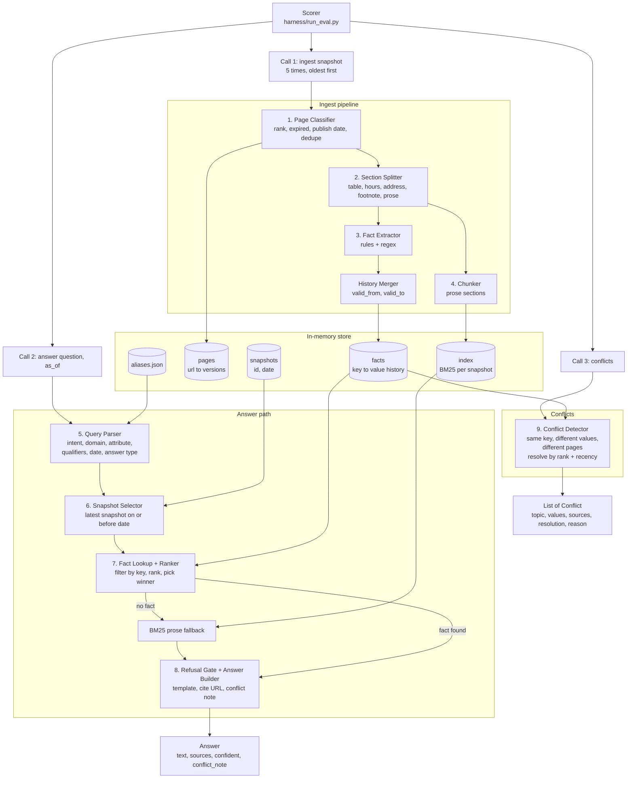
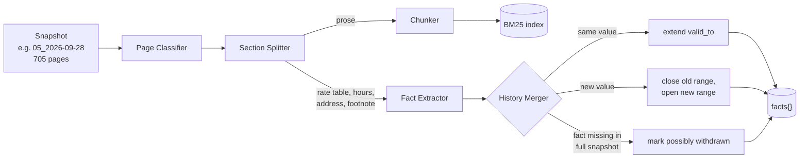
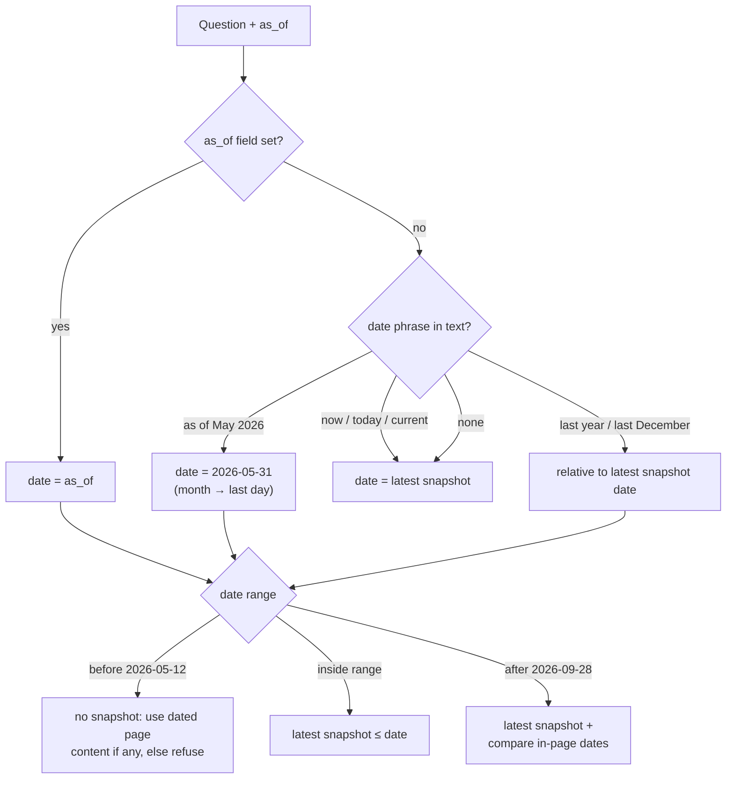
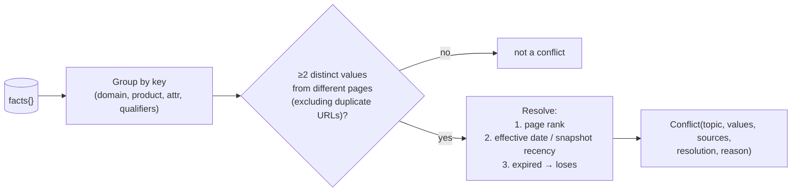
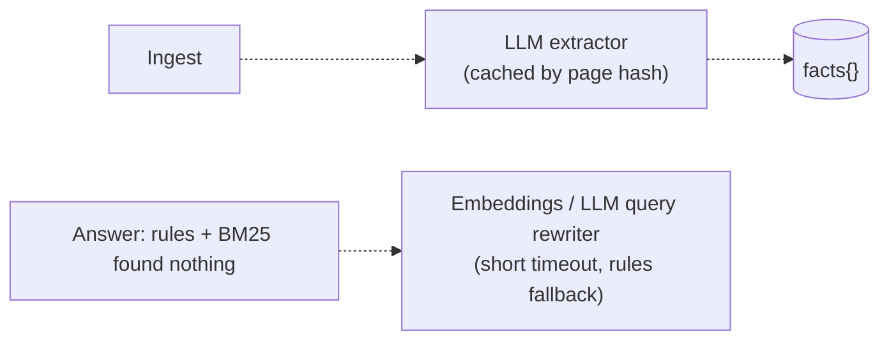

# Knowledge System: Plan & Architecture

A system that reads five dated snapshots of a credit-union website and answers members'
questions with the **current, correctly-tiered value**, a **source**, and an honest
**"I don't know"** when the site doesn't say.

---

## 1. Requirements (from the assignment PDF and the harness)

| Item | Requirement |
|---|---|
| Deliverable | Folder with `solution.py` exposing `build()` → object with `ingest()`, `answer()`, `conflicts()` |
| Contract | `harness/contract.py` (`Snapshot`, `Page`, `Answer`, `Source`, `Conflict`). Don't rename anything. |
| Extras | `requirements.txt` (clean **Python 3.11** env), `NOTES.md` (approach + API keys) |
| Submission | GitHub repo + commit; any folder except `starter/` |
| Rules | Answer only from snapshots, no live web calls; each `answer()` < 60 s; ingest < 30 min; don't redistribute data |

### Scoring (`harness/scoring.py`)

| Pillar | Weight | How it is measured |
|---|---|---|
| Accuracy | 55% | Share of `must_include` values present; **any `must_not_include` value → 0**. Item = 0.85·correctness + 0.15·source hit |
| Conflicts | 15% | 0.7·F1 vs hidden gold list + 0.3·correct winner (match = ≥2 gold values, or 1 value + topic keyword) |
| Consistency | 15% | Same numeric values across paraphrases and across a repeat pass (× accuracy) |
| Speed | 15% | p95 latency ≤ 2 s → 1.0, linear to 0 at 20 s (× accuracy) |

Notes:
- `should_refuse` questions get credit only if the answer declines **and contains no numbers** beyond those in the question.
- Numbers are compared by value (`5.39%` == `5.390 %`). Hedging with several values fails.

### Data

| Snapshot | Date | Pages |
|---|---|---|
| `01_2026-05-12_baseline` | 12 May 2026 | 637 |
| `02_2026-05-19_recrawl` | 19 May 2026 | 634 |
| `03_2026-06-09_recrawl` | 9 Jun 2026 | 635 |
| `04_2026-08-27_rebaseline` | 27 Aug 2026 | 683 |
| `05_2026-09-28_latest` | 28 Sep 2026 ("current") | 705 |

About 6.5 MB of markdown per snapshot. Most of it is noise: ~255 blog pages and ~166 newsroom pages.
The authoritative facts sit on a few pages: `/rates`, `/business-rates`, product pages, and branch pages.

### Practice questions (40)

| Category | n | Main challenge |
|---|---|---|
| stale_trap | 7 | Old page / calculator / press release shows an outdated value |
| tier_disambiguation | 6 | Pick the right term / balance / loan-amount tier |
| branch_info | 6 | Hours, addresses |
| list_completeness | 4 | List every item (e.g., all four credit cards) |
| entity_attribution | 4 | Right fact for the right product/entity |
| temporal_as_of | 4 | Answer as the site stood on a date |
| conflict_resolution | 3 | Pick the winning value |
| current_value | 3 | Latest value |
| should_refuse | 3 | Site doesn't say → decline, no numbers |

---

## 2. Design decisions

| Decision | Choice | Why |
|---|---|---|
| Agent? | **No** | Fixed call sequence, no tool use. An agent adds latency and non-determinism. |
| LLM? | **Not required** (optional add-on) | Rules are fast, deterministic and keyless. The grader may have no API key. |
| RAG vs knowledge graph | **Temporal fact store + BM25** | Plain RAG can't tell stale or wrong-tier values apart. A full KG is overkill. A fact table keyed by qualifiers, with history, is a lightweight KG. |
| Database? | **None, in memory** | ~3,300 page versions; rebuilt by `ingest()` each run; no DB server exists in the grader env. |
| Libraries | stdlib (+ optional `rank-bm25`) | Clean 3.11 install, no network |

### Source-ranking rules ("what is current")

1. Official rates page > product page > promo/landing page > calculator > blog > newsroom > files.
2. Same rank → newer snapshot / newer in-page effective date wins.
3. Expired offer pages ("Offer Has Expired") lose.
4. Different term / tier / model year / rate-vs-APY / personal-vs-business = **different facts, not conflicts**.
5. No supporting fact → refuse (no numbers in the refusal).

---

## 3. Architecture overview



---

## 4. Ingest pipeline



### 4.1 Page classification

| Rank | Type | Detected by | ~Count (snap 05) |
|---|---|---|---|
| 1 | Official rates | `/rates`, `/business-rates`; "effective as of" tables | 2 |
| 2 | Product / service | `/personal/...`, `/business/...` (not `/resources`), `/about`, `/contact` | ~60 |
| 3 | Promo / landing | `*-lp`, `/switch-and-earn` | ~10 |
| 4 | Calculator | `calculators` in path | 34 |
| 5 | Blog / education | `/learn/...`, `/business/resources/...` | 255+ |
| 6 | Newsroom / PR | `/newsroom/...`, `/20xx/...` | 166 |
| 7 | Files | `/hubfs/*.pdf`, `.xlsx` | 28 |
| X | Expired / listing | title "Offer Has Expired"; author/tag pages | few |

Also stored: publish date (news/blog), expired flag, duplicate-URL groups
(e.g., `/personal/loans/auto-loans/` = `/personal/loans/auto-motorcycle-loans`).

### 4.2 Section classification

| Section | Signal | Output |
|---|---|---|
| Rate table | Markdown table with `%` + headers Rate/APY/APR/Term/Minimum | One fact per row |
| Hours block | `Mon–Fri 9 a.m.–5 p.m.`, "Lobby", "Drive-up" | Hours facts |
| Address / contact | Street/ZIP/phone, "routing number" | Branch / contact facts |
| Footnote | Superscript-number lines (`1Fixed Jumbo…`) | Qualifiers attached to rows |
| Prose | everything else | BM25 chunks |

### 4.3 Fact record

```python
key = (domain, product, attribute, qualifiers)
# e.g. ("certificate", "10 month fixed jumbo special", "apy", "min $100,000")

facts[key] = [
  {"value": "3.90%", "valid_from": "2026-05-12", "valid_to": "2026-08-27",
   "url": "https://www.dupaco.com/rates", "rank": 1, "effective": None,
   "snapshot": "01_2026-05-12_baseline", "quote": "| 10 Month Fixed Jumbo ... |"},
  {"value": "4.00%", "valid_from": "2026-09-28", "valid_to": None, ...},
]
```

Qualifiers keep tiers apart, e.g. mortgage 30-yr ≤ $100k (7.13%) vs ≤ $832,750 (7.25%)
are **two facts**, not a conflict.

---

## 5. Answer path

```mermaid
sequenceDiagram
    participant S as Scorer
    participant QP as Query Parser
    participant SEL as Snapshot Selector
    participant FL as Fact Lookup + Ranker
    participant BM as BM25 Fallback
    participant AB as Answer Builder

    S->>QP: "10-month jumbo special rate as of May 2026?"
    QP->>SEL: domain=certificate, attr=apy, date=2026-05-31, type=single
    SEL->>FL: snapshot 02_2026-05-19
    FL->>FL: filter key, keep facts valid on date, rank
    alt fact found
        FL->>AB: 3.90% (/rates, rank 1)
    else no fact
        FL->>BM: search prose chunks
        BM->>AB: best passage or nothing
    end
    AB->>S: Answer("...paid 3.90% APY...", source=/rates@02, confident=True)
    Note over AB: No support → "It isn't listed; please contact us." (no numbers)
```

### 5.1 Answer types

| Type | Example | Behaviour |
|---|---|---|
| single | "60-month auto APR, 2025 model year" | One tier's value |
| headline | "mortgage rates right now" | Lead with default tier ($100k), don't dump all tiers |
| list | "what credit cards do you offer" | Every item with its value |
| url | "link for CD rates" | Current URL, not old one |
| date/event | "when does Hy-Vee close" | In-page date |
| prose | "what is Home$tart" | BM25 extractive passage |
| refuse | "7/1 ARM rate" (not on site) | Decline, no numbers |

---

## 6. Date handling



- **Website time** = what the site said on date D (snapshot selection).
- **Content time** = dates written in pages ("effective as of 06/02/2026", "closes March 31, 2026", "in 2023, 294 employees").
  Stored with facts, and used for questions like *"Is Hy-Vee still open today (October 2026)?"* → closed March 31, 2026.
- "Last year" answers **always state the year** (e.g., "294 employees (2023)").

Real example, 10-month jumbo special APY on `/rates`:

| Snapshot | 01 | 02 | 03 | 04 | 05 |
|---|---|---|---|---|---|
| APY | 3.90% | 3.90% | 3.90% | 3.90% | 4.00% |

"As of May 2026" → snapshot 02 → **3.90%**. No date → snapshot 05 → **4.00%**.

---

## 7. Conflict detection



Example: 60-month auto APR (2024–27 model years):
`5.39%` on `/rates` (rank 1) and the auto-loan page (rank 2) vs `5.34%` on the vehicle-affordability
calculator (rank 4) → **resolution 5.39%**, reason *"official rate page; calculator is stale"*.

Precision matters (F1): tiers, rate-vs-APY and duplicate URLs are **not** reported.

---

## 8. Optional add-ons (not in the required path)



Add only if measured misses justify it. Candidates: Gemini free tier, Groq free tier, OpenRouter
`:free` models, local Ollama, local `fastembed`. Constraints:
- System must work **with no API key**.
- Prefer LLM at **ingest** (untimed), not per question (p95 ≤ 2 s).
- Hosted APIs send page text off-machine. Check the "event only" data rule first.

---

## 9. Build plan

| # | Step | Output |
|---|---|---|
| 1 | Data exploration: rate-table formats, effective dates, branch data, URL facts across 5 snapshots; hand-label 15–20 conflicts | Notes + `dev/conflicts_gold.json` |
| 2 | Page classifier + section splitter + fact extractor (qualifiers, in-page dates, per-fact rank) | `facts{}` |
| 3 | Query parser: intent, qualifiers, dates in text, alias dictionary | Parsed query |
| 4 | Answer builder: answer types, templates, number-free refusal | `answer()` |
| 5 | `as_of`, withdrawn facts, URL facts | Temporal correctness |
| 6 | `conflicts()` from fact store; score vs hand-labelled list | `conflicts()` |
| 7 | BM25 prose fallback | Prose/list coverage |
| 8 | Hold-out set: ~3 rewordings per practice question + generated `as_of` tests from snapshot diffs; check consistency and p95 latency | Overfitting guard |
| 9 | Optional LLM/embeddings for remaining misses | Only if needed |
| 10 | Clean Python 3.11 venv test, `NOTES.md`, push to GitHub | Submission |

### Proposed layout

```
my_solution/
├── solution.py        # build() + KnowledgeSystem (ingest / answer / conflicts)
├── classify.py        # page + section classification
├── extract.py         # fact extraction (tables, hours, addresses, URLs, dates)
├── query.py           # query parser + date resolution
├── store.py           # fact history, snapshot selection
├── answer.py          # ranking, answer types, templates, refusal
├── search.py          # BM25 fallback
├── aliases.json       # synonyms
├── requirements.txt
└── NOTES.md
```

### Verification

```bash
python harness/run_eval.py --submission my_solution --eval eval/public_eval.jsonl
python harness/run_eval.py --submission my_solution --eval dev/holdout_eval.jsonl
```

Read `results/per_question.jsonl` for misses and trap hits, not just the total score.

---

## 10. Risks

| Risk | Mitigation |
|---|---|
| Rules overfit to 40 practice questions | General extractors per page type; reworded hold-out set |
| Changes between snapshots (e.g., June–Aug gap) not visible | Answer "as the website stood"; documented in `NOTES.md` |
| Headline vs list scope chosen wrongly | Explicit answer-type rules; test on rewordings |
| Conflict precision (tiers reported as conflicts) | Full qualifiers in key; duplicate-URL groups |
| Python 3.14 (dev) vs 3.11 (grader) | Avoid newer syntax; test in 3.11 venv |
