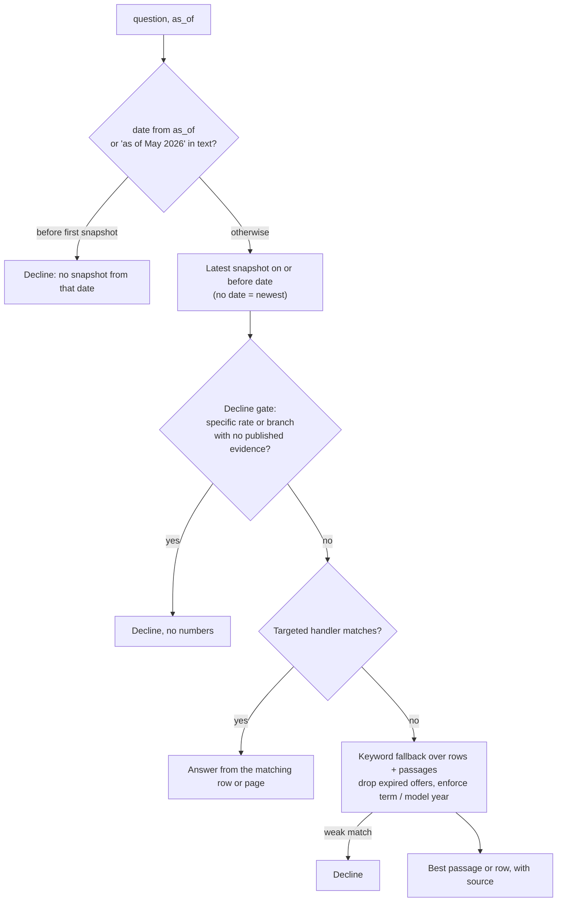
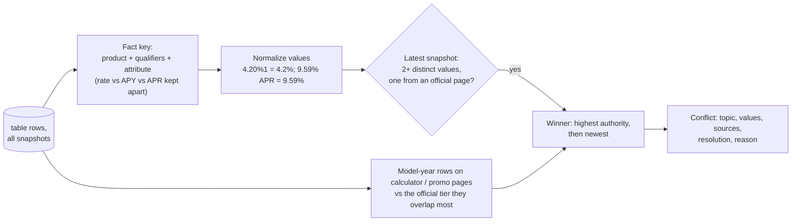

# Knowledge System: Architecture (as built)

A deterministic Python system that reads five dated snapshots of a credit-union website and
answers member questions with the **current, correctly-tiered value**, a **source**, and an honest
**"the website doesn't list that"** when the site doesn't say.

This document describes the code in `submission/solution.py` as it exists. Section 9 records how
it differs from the original plan and why.

---

## 1. Requirements

| Item | Requirement |
|---|---|
| Deliverable | `solution.py` exposing `build()` → object with `ingest()`, `answer()`, `conflicts()` |
| Contract | `harness/contract.py` (`Snapshot`, `Page`, `Answer`, `Source`, `Conflict`) |
| Extras | `requirements.txt`, `NOTES.md` (approach + API keys); graded in a clean **Python 3.11** env |
| Rules | Snapshots only, no live web calls; each `answer()` < 60 s; ingest < 30 min; don't redistribute data |

### Scoring (`harness/scoring.py`)

| Pillar | Weight | Measured as |
|---|---|---|
| Accuracy | 55% | Share of `must_include` values present; **any `must_not_include` value → 0**. Item = 0.85·correctness + 0.15·source hit |
| Conflicts | 15% | 0.7·F1 vs hidden gold list + 0.3·correct winner |
| Consistency | 15% | Same numeric values across paraphrases and a repeat pass (× accuracy) |
| Speed | 15% | p95 ≤ 2 s → 1.0, linear to 0 at 20 s (× accuracy) |

### Data

| Snapshot | Date | Pages |
|---|---|---|
| `01_2026-05-12_baseline` | 12 May 2026 | 637 |
| `02_2026-05-19_recrawl` | 19 May 2026 | 634 |
| `03_2026-06-09_recrawl` | 9 Jun 2026 | 635 |
| `04_2026-08-27_rebaseline` | 27 Aug 2026 | 683 |
| `05_2026-09-28_latest` | 28 Sep 2026 ("current") | 705 |

---

## 2. Design decisions

| Decision | Choice | Why |
|---|---|---|
| Agent? | No | Fixed call sequence and no tool use; an agent adds latency and non-determinism |
| LLM? | No | Rules are fast, repeatable and keyless; the grader has no guaranteed API key |
| RAG vs knowledge graph | Table-row index + targeted rules + keyword fallback | Similarity search can't tell a stale calculator value from the official rate, or two tiers apart |
| Database | None; in memory | ~3,300 page versions, rebuilt by `ingest()` on every scorer run |
| Libraries | Python standard library only | Clean 3.11 install, offline |

### Source authority (`_page_rank`)

| Rank | Page type | Detected by |
|---|---|---|
| 1 | Official rate sheet | `/rates`, `/business-rates`, `/rates/...` |
| 2 | Product / service pages | `/personal/...`, `/business/...`, `/about/...`, `/contact` |
| 3 | Promo / landing | `*-lp`, `/switch-and-earn`, `offer` in path |
| 4 | Calculator | `calculator` in path |
| 5 | Blog / education | `/learn/...`, `/business/resources/...` |
| 6 | Newsroom | `/newsroom/...`, `/20xx/...` |
| 7 | Files | `/hubfs/...` |
| 99 | Expired | "Offer has expired" title, or "offer ended YYYY-MM-DD" in text |

Lower rank wins. Ties go to the newer snapshot. Unmatched paths default to rank 5. The checks run in a fixed order, so a calculator under `/personal/...` is still rank 4.

---

## 3. Architecture overview

```mermaid
flowchart TB
    H["Scorer<br/>harness/run_eval.py"]
    C1["ingest snapshot<br/>5 times, oldest first"]
    C2["answer question, as_of"]
    C3["conflicts"]
    H --> C1
    H --> C2
    H --> C3

    subgraph ING["Ingest (per snapshot)"]
        direction TB
        PR["Page authority rank<br/>_page_rank"]
        TR["Table-row parser<br/>_table_rows"]
        CH["Prose chunker<br/>_chunks"]
        PR --> TR
        PR --> CH
    end

    subgraph STORE["In-memory store"]
        direction TB
        S1[("snapshots<br/>id, date")]
        S2[("pages_by_snapshot")]
        S3[("rows_by_snapshot<br/>cells, rank, effective date")]
        S4[("passages_by_snapshot<br/>terms, expiry date")]
    end

    subgraph ANS["Answer path"]
        direction TB
        SEL["1. Snapshot selector<br/>latest on or before date"]
        DEC["2. Decline gate<br/>unpublished rates or branches"]
        RH["3. Targeted handlers<br/>rates, branches, mortgage,<br/>product lists, prose facts"]
        FB["4. Keyword fallback<br/>IDF-weighted, authority-boosted"]
        SEL --> DEC --> RH
        RH -->|no handler matched| FB
    end

    subgraph CON["Conflicts"]
        FK["Fact keys<br/>product, qualifiers, attribute"]
        CD["Current-snapshot disagreements<br/>+ stale model-year rows"]
        FK --> CD
    end

    C1 --> PR
    TR --> S3
    CH --> S4
    PR --> S2
    C2 --> SEL
    S1 --> SEL
    S2 --> RH
    S3 --> RH
    S4 --> FB
    C3 --> FK
    S3 --> FK

    RH --> OUT1["Answer<br/>text, sources, confident"]
    FB --> OUT1
    DEC --> OUT1
    CD --> OUT2["List of Conflict<br/>topic, values, sources, resolution, reason"]
```



---

## 4. Ingest

For each snapshot, every page becomes a record with its URL, title, text, snapshot id/date and
authority rank. From each page:

- **Table rows** (`_table_rows`): each Markdown table row keeps its header→cell mapping, the nearest
  heading, and any "effective as of MM/DD/YYYY" date found near the table.
- **Prose passages** (`_chunks`): paragraphs split at headings, each with a keyword set and any
  "offer ended YYYY-MM-DD" expiry date.

Everything is held per snapshot (`rows_by_snapshot`, `passages_by_snapshot`, `pages_by_snapshot`),
so an `as_of` question simply reads a different snapshot. Nothing is merged across snapshots for
answering; history *is* the set of snapshots.

---

## 5. Answer path



### Targeted handlers

Each handler reads its value from the page in the selected snapshot; none returns fixed answer text.

| Handler | Answers | Reads from |
|---|---|---|
| `_direct_rate_lookup_answer` | Personal-loan APR by term; named deposit product APY/dividend, choosing the tier that contains any $ amount in the question | `/personal/loans/personal-loans`, `/rates` |
| `_direct_branch_or_checking_answer` | Checking rates; branch/ATM street address by city or street; lobby/drive-up hours (lists every published schedule, asks which branch) | `/rates`, `/contact`, branch newsroom posts |
| `_direct_mortgage_rate_answer` | Purchase mortgage rates; smallest loan-amount tier containing the requested amount; headline tier for broad questions | `/rates` |
| `_direct_product_list_answer` | Credit-card APRs (all or a named card); certificate rates (all, or a named term / jumbo); certificate-rates link; mobile wallets | card pages, `/rates`, mobile-payments page |
| `_direct_general_fact_answer` | Home$tart amount; membership eligibility (bullets from the join page); phone; branch locator URL; branch closure date and alternatives; contact updates; student loans; Volunteer Time Off by year; Forbes recognition (article matching the question); join link; "do any tiers pay X%?" (checks every tier) | the relevant page in the snapshot |

### Keyword fallback

When no handler matches: score table rows and passages by IDF-weighted keyword overlap, boosted by
authority and domain hints, then enforce hard filters. Expired offers are dropped. Certificate
questions must match the requested term, and auto-loan questions the requested term and model
year. If nothing matches in the selected snapshot, older snapshots are tried for prose only. A
weak best score declines.

---

## 6. Dates

- **Website time:** answers come from the latest snapshot on or before the date. With no date, the
  newest snapshot is used. Before 12 May 2026, the system declines.
- **Content time:** dates written in pages are used where the question needs them: closure dates
  ("will close March 31, 2026") are compared with the snapshot date, and year-specific facts (e.g.
  Volunteer Time Off by year) match the year asked. A year the site doesn't report declines.

---

## 7. Conflict detection



- Only contradictions **within the current snapshot** are reported. A rate that changed between
  crawls is history, handled by `as_of`, not a self-conflict.
- Disagreements among calculators and articles alone are skipped, because there's no reliable winner.
- If a dividend-rate change only mirrors the APY change, only the APY conflict is reported.

---

## 8. Verification

```bash
uv run --python 3.11 python -m unittest submission.test_regressions -v
python3 harness/run_eval.py --submission submission --eval eval/public_eval.jsonl
python3 harness/run_eval.py --submission submission --eval dev/holdout_eval.jsonl
python3 dev/build_eval80.py
python3 harness/run_eval.py --submission submission --eval dev/eval80.jsonl --conflicts-gold dev/conflicts_gold80.json
```

| Check | What it guards |
|---|---|
| `submission/test_regressions.py` | as-of, term decline, conflict history, certificate list completeness, and reworded questions that must use page values |
| `eval/public_eval.jsonl` | the 40 official practice questions |
| `dev/holdout_eval.jsonl` | 16 independently worded questions |
| `dev/eval80.jsonl` | 124 questions whose answers `dev/build_eval80.py` parses from raw snapshots without importing `solution.py` |
| `harness/selftest` | bundled fixture, including its conflict gold |

The dev sets were used to find and fix bugs, so their scores are regression checks, not
estimates of hidden-set performance.

---

## 9. Plan vs. as built

The original plan proposed a richer structure. What was built is simpler where the data allowed it:

| Planned | Built | Reason |
|---|---|---|
| Modules: `classify.py`, `extract.py`, `query.py`, `store.py`, `answer.py`, `search.py` | One file, `submission/solution.py` | Simplest drop-in for the scorer; candidate for refactoring (see `NOTES.md`) |
| `aliases.json` | `ALIASES` dict in code | A handful of synonyms didn't justify a config file |
| `rank-bm25` library | Hand-written IDF-weighted keyword scorer | Keeps the submission stdlib-only |
| Unified `facts{}` store with `valid_from`/`valid_to` history, used for answers and conflicts | Answers read per-snapshot rows via handlers; a fact store is built only for conflicts | Per-snapshot indexes made `as_of` trivial; targeted handlers gave more precise tier selection |
| "History Merger" marking withdrawn facts | Not built; historical prose is a last-resort fallback | Not needed by any observed question |
| Optional LLM / embeddings | Not used | Rules + fallback covered the dev sets; see risks in `NOTES.md` |
